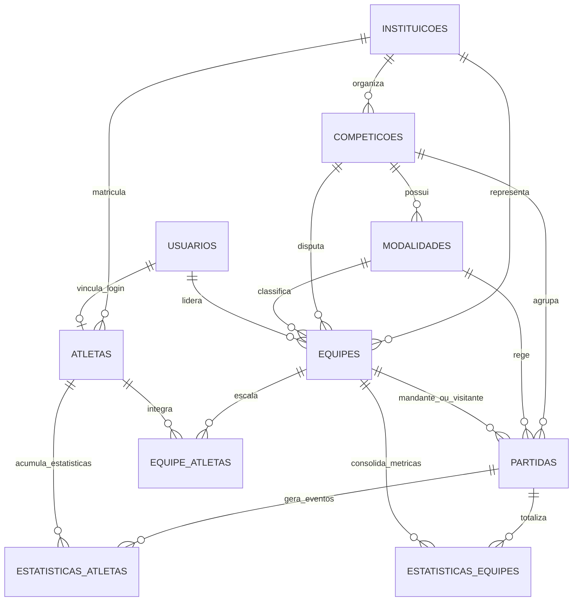

# JIF+ — Plataforma de Gestão e Inteligência Esportiva para os Jogos dos Institutos Federais
## Especificação de Requisitos e Arquitetura do Sistema (Versão 1.0.10 — CI sem senha fixa e instalador validado)

---

### Identificação do Projeto

- **Nome do Projeto**: JIF+ (Plataforma de Gestão e Inteligência Esportiva para os Jogos dos Institutos Federais)
- **Instituição de Ensino**: Instituto Federal de Educação, Ciência e Tecnologia de Rondônia (IFRO) — Campus Porto Velho Calama
- **Curso**: Técnico em Informática Integrado ao Ensino Médio (3º Ano)
- **Disciplina**: Desenvolvimento de Sistemas (4º Bimestre)
- **Docente Responsável**: Prof. Rafael Pitwak
- **Estudante Autor**: Arthur Henrique Gimax Oliveira
- **Repositório Oficial**: [github.com/arthurgimax/JIF-](https://github.com/arthurgimax/JIF-)
- **Versão do Documento**: 1.0.6 (HTTPS confirmado e revisão final de publicação)
- **Data da Revisão**: 13 de novembro de 2026

---

## 1. Introdução e Contextualização

Os Jogos dos Institutos Federais (JIF) constituem o maior evento poliesportivo da Rede Federal de Educação Profissional, Científica e Tecnológica do Brasil. Reunindo milhares de estudantes-atletas em etapas locais (como os Jogos Intercampi do IFRO — JIFRO), regionais (JIF Norte) e na etapa nacional consolidada, essas competições fomentam a integração comunitária, a cidadania, o espírito esportivo e o desenvolvimento socioemocional dos jovens.

Apesar de sua relevância institucional e desportiva, os processos de gestão, registro e comunicação dos eventos esportivos historicamente carecem de centralização tecnológica. Na rotina dos jogos, as informações de delegações, equipes, atletas, tabelas de confrontos e súmulas são frequentemente fragmentadas em planilhas locais, arquivos de texto avulsos, impressões em papel e boletins informativos distribuídos em formato PDF através de aplicativos de mensagens instantâneas.

O **JIF+** nasce no âmbito acadêmico do IFRO — Campus Porto Velho Calama como uma solução web robusta, segura e moderna para unificar todo o ciclo de vida informacional dos jogos em uma única plataforma digital. O sistema conecta coordenadores de eventos, docentes de Educação Física, técnicos desportivos, estudantes-atletas e a comunidade acadêmica em geral, garantindo transparência, integridade referencial dos dados e agilidade nas tomadas de decisão esportiva.

---

## 2. Problema Identificado

Durante a auditoria de processos operacionais dos jogos escolares e intercampi, identificaram-se os seguintes gargalos estruturais:

1. **Fragmentação e Dispersão de Dados**: Publicação de boletins em arquivos PDF desarticulados, o que dificulta buscas históricas e a consulta instantânea por parte de estudantes e familiares.
2. **Lentidão e Falhas no Cálculo Manual**: A apuração manual de tabelas de classificação, saldo de gols, critérios de desempate e estatísticas individuais (artilharia e disciplina) demanda tempo excessivo e gera margem para divergências entre comissões técnicas.
3. **Perda da Memória Esportiva e Inexistência de BID**: A ausência de um Boletim Informativo Diário (BID) e de um repositório centralizado impede a preservação da trajetória e do histórico esportivo dos estudantes-atletas ao longo dos anos de permanência no Instituto Federal.
4. **Falta de Transparência e Acompanhamento em Tempo Real**: Estudantes, servidores e familiares que acompanham os jogos à distância não dispõem de um ambiente centralizado para consultar confrontos agendados, placares homologados e classificações atualizadas.
5. **Vulnerabilidade e Insegurança em Ambientes de Controle**: Ausência de controle de permissões por nível de usuário (RBAC) em processos manuais, permitindo inconsistências de inscrições e alterações indevidas em súmulas.

---

## 3. Objetivo Geral e Objetivos Específicos

### 3.1. Objetivo Geral
Desenvolver e implantar a plataforma web **JIF+**, centralizando a gestão de instituições, competições, modalidades, equipes, atletas, partidas, súmulas e classificações, além de disponibilizar módulos de inteligência e estatística esportiva orientados à Rede Federal de Educação Profissional e Tecnológica.

### 3.2. Objetivos Específicos
- **Modelar e estruturar** um banco de dados relacional íntegro, composto por 10 entidades mapeadas, assegurando integridade referencial estrita (`FOREIGN KEY`) e suporte a transações ACID.
- **Implementar controle de acesso baseado em papéis (RBAC)**, distinguindo os privilégios operacionais de Administradores, Organizadores, Treinadores, Atletas e Visitantes.
- **Construir súmula eletrônica interativa** capaz de homologar placares e vincular eventos individuais (gols, pontos, faltas e cartões) diretamente aos atletas participantes.
- **Automatizar a computação de tabelas de classificação**, aplicando pontuação oficial (3 pontos por vitória, 1 por empate) e critérios desportivos de desempate (saldo de gols, gols pró e confrontos).
- **Consolidar o Boletim Informativo do Atleta (BID)**, fornecendo perfil individual detalhado com foto, dorsal, posição, histórico de jogos disputados e métricas acumuladas.
- **Disponibilizar painéis analíticos de inteligência esportiva**, incluindo ranking de artilharia (Chuteira de Ouro), eficiência ofensiva por campus e Troféu Fair Play (indicador disciplinar).
- **Garantir estrita conformidade com as boas práticas de segurança** preconizadas na apostila acadêmica *Programar com IA de forma responsável*, protegendo senhas via algoritmo bcrypt e blindando o sistema contra injeções de SQL por meio de prepared statements com PDO.

---

## 4. Escopo do Sistema

### 4.1. Módulos Implementados no Escopo Oficial (Versão 1.0)
- **Módulo de Acesso e Identidade**: Registro público de novos usuários, login com validação segura de credenciais, encerramento de sessão (logout) e barramento RBAC para proteção de rotas restritas.
- **Módulo Institucional e Organizacional**: Cadastro e manutenção dos campi dos Institutos Federais, gestão de torneios oficiais (JIFRO, JIF Regional) e parametrização de esportes por categoria (masculino, feminino, misto) e formato (coletivo ou individual).
- **Módulo de Delegações e Elencos**: Inscrição de equipes representativas por campus/modalidade, associação de técnicos responsáveis e vinculação de estudantes-atletas com dorsal e posição.
- **Módulo de Competições e Tabela de Jogos**: Programação de partidas com data, horário, local/quadra e fase, impedindo confrontos entre equipes de modalidades distintas ou da mesma instituição em chaveamento irregular.
- **Módulo de Súmula e Homologação de Resultados**: Lançamento de placares, encerramento oficial de partidas e registro minucioso de estatísticas por atleta (gols, advertências e expulsões).
- **Módulo de Classificação e Inteligência**: Exibição pública de tabelas calculadas automaticamente e painéis gráficos com destaques individuais e coletivos dos Institutos Federais.
- **Módulo Administrativo Integrado (`/admin`)**: Painel de governança restrito para auditagem, controle de permissões de usuários e ativação/inativação de cadastros.

---

## 5. Público-Alvo e Perfis de Usuários (RBAC)

O sistema implementa o modelo de Controle de Acesso Baseado em Papéis (*Role-Based Access Control* — RBAC), discriminando cinco níveis operacionais estritos definidos no arquivo [`config/auth.php`](config/auth.php):

| Perfil | Identificador Técnico | Escopo de Permissões e Ações Permitidas |
| :--- | :--- | :--- |
| **Administrador Geral** | `admin` | Acesso irrestrito a todas as áreas do sistema. Responsável por cadastrar instituições/campi, gerenciar usuários, alterar perfis de acesso, auditar registros e intervir globalmente nas competições. |
| **Coordenador / Organizador** | `organizador` | Responsável por criar competições, definir modalidades esportivas oficiais, homologar inscrições, agendar partidas, preencher a súmula eletrônica com placares e eventos, e publicar classificações. |
| **Treinador / Professor** | `treinador` | Responsável por inscrever equipes representativas do seu campus nas competições ativas, gerenciar o elenco de estudantes-atletas sob sua tutela e acompanhar o rendimento tático de sua equipe. |
| **Estudante-Atleta** | `atleta` | Acesso ao seu Boletim Informativo Diário (BID) individual, consulta de suas estatísticas pessoais acumuladas (gols, cartões e jogos), histórico de equipes que integrou e acompanhamento do calendário. |
| **Visitante / Público Geral** | `visitante` *(não autenticado)* | Consulta pública em modo somente-leitura aos placares em tempo real, tabelas de classificação, páginas de equipes, perfis BID e painéis de inteligência, sem permissão para criar ou modificar dados. |

---

## 6. Casos de Uso

A dinâmica operacional do JIF+ é norteada por 12 casos de uso principais, cujos fluxos estão implementados no código e precisam ser reexecutados na homologação final:

- **UC01 — Cadastrar-se e autenticar-se no sistema**:
  - *Ator*: Visitante / Usuário.
  - *Fluxo Principal*: O visitante acessa a tela de cadastro, preenche nome, e-mail e senha. O sistema valida os campos, criptografa a senha com hash bcrypt e grava o registro. Na tela de login, informa credenciais; o sistema autentica contra o banco relacional, regenera o ID de sessão e direciona o usuário ao painel correspondente ao seu perfil.
- **UC02 — Gerenciar usuários e permissões de acesso**:
  - *Ator*: Administrador Geral.
  - *Fluxo Principal*: O administrador acessa `admin/usuarios.php`, visualiza a listagem de contas registradas, altera o perfil funcional (`admin`, `organizador`, `treinador`, `atleta`) e ativa ou suspende contas.
- **UC03 — Gerenciar instituições e campi**:
  - *Ator*: Administrador Geral.
  - *Fluxo Principal*: Em `admin/instituicoes.php`, cadastra novos campi dos Institutos Federais informando sigla, nome, campus e unidade federativa (UF).
- **UC04 — Gerenciar competições e modalidades esportivas**:
  - *Ator*: Coordenador / Organizador.
  - *Fluxo Principal*: Cadastra eventos (ex.: JIFRO 2026) com período de realização, local-sede e status operacional. Vincula as modalidades oficiais (Futsal, Vôlei, Basquete, Xadrez, Atletismo) definindo categoria e formato.
- **UC05 — Gerenciar equipes representativas**:
  - *Ator*: Treinador ou Coordenador.
  - *Fluxo Principal*: Registra a equipe vinculando-a obrigatoriamente a uma instituição, uma competição e uma modalidade ativa, indicando o professor responsável.
- **UC06 — Gerenciar atletas e inscrição em equipes**:
  - *Ator*: Treinador ou Coordenador.
  - *Fluxo Principal*: Cadastra os dados do estudante-atleta (nome, matrícula institucional e data de nascimento) e o inscreve na equipe designando o número da camisa (dorsal) e sua posição esportiva.
- **UC07 — Agendar e programar partidas**:
  - *Ator*: Coordenador / Organizador.
  - *Fluxo Principal*: Cria o confronto selecionando a competição, a modalidade, as duas equipes adversárias (mandante e visitante distintas), fase/rodada, data, horário e quadra/local de disputa.
- **UC08 — Registrar súmula eletrônica e estatísticas**:
  - *Ator*: Coordenador / Organizador.
  - *Fluxo Principal*: Na tela `admin/sumula.php`, o coordenador atualiza os placares parciais/finais, registra eventos individuais (gols marcados, cartões amarelos, cartões vermelhos e faltas) vinculados aos atletas e encerra oficialmente o jogo.
- **UC09 — Consultar página da equipe e histórico**:
  - *Ator*: Todos os perfis / Visitante.
  - *Fluxo Principal*: O usuário acessa a tela de equipes, filtra por campus ou esporte e visualiza o elenco completo, comissão técnica, calendário de partidas e resultados anteriores.
- **UC10 — Pesquisar e filtrar informações esportivas**:
  - *Ator*: Todos os perfis / Visitante.
  - *Fluxo Principal*: Aplicação de buscas textuais e filtros combinados por campus, modalidade, atleta ou competição nas páginas públicas da plataforma.
- **UC11 — Visualizar painéis de inteligência e desempenho**:
  - *Ator*: Todos os perfis / Visitante.
  - *Fluxo Principal*: Consulta visual aos rankings de artilharia (Chuteira de Ouro), eficiência ofensiva por campus participante e índice de disciplina (Fair Play) calculados a partir dos dados consolidados das súmulas.
- **UC12 — Validar regras de negócio e garantir persistência**:
  - *Ator*: Sistema / Backend PHP.
  - *Fluxo Principal*: Intercepta toda requisição de entrada, sanitiza strings, valida restrições no servidor e persiste os dados em tabelas InnoDB utilizando transações e queries parametrizadas.

---

## 7. Requisitos Funcionais

A tabela a seguir consolida os 17 Requisitos Funcionais (RF01 a RF17), indicando o status verificado em código-fonte e os arquivos de implementação:

| Código | Descrição do Requisito Funcional | Status Real | Arquivos de Implementação no Sistema |
| :--- | :--- | :---: | :--- |
| **RF01** | Autocadastro de usuários com validação de formato de e-mail, verificação de duplicidade e obrigatoriedade de senha com mínimo de 6 caracteres. | **Implementado** | [`cadastro.php`](./cadastro.php), [`config/auth.php`](config/auth.php) |
| **RF02** | Autenticação de credenciais via e-mail e senha, controle de sessão ativa, proteção contra Session Fixation e encerramento seguro (logout). | **Implementado** | [`login.php`](./login.php), [`logout.php`](./logout.php), [`config/auth.php`](config/auth.php) |
| **RF03** | Controle estrito de acesso e permissões (RBAC) bloqueando o acesso de usuários não autorizados a rotas administrativas (`HTTP 403`). | **Implementado** | [`config/auth.php`](config/auth.php), [`admin/usuarios.php`](./admin/usuarios.php) |
| **RF04** | Gestão de instituições e campi participantes (cadastro, listagem e vinculação geográfica por UF). | **Implementado** | [`admin/instituicoes.php`](./admin/instituicoes.php) |
| **RF05** | Gestão de competições (cadastro de edição, ano, períodos de início/término, local-sede e controle de status: planejada, em andamento, encerrada). | **Implementado** | [`admin/competicoes.php`](./admin/competicoes.php), [`competicoes.php`](./competicoes.php) |
| **RF06** | Gestão de modalidades esportivas com vínculo direto à competição, definindo categoria (masculino/feminino/misto) e formato (coletiva/individual). | **Implementado** | [`admin/modalidades.php`](./admin/modalidades.php), [`modalidades.php`](./modalidades.php) |
| **RF07** | Gestão de equipes esportivas associadas a campus, competição, modalidade e técnico responsável, prevenindo duplicidades. | **Implementado** | [`admin/equipes.php`](./admin/equipes.php), [`equipes.php`](./equipes.php) |
| **RF08** | Cadastro e inscrição de atletas em equipes, registrando matrícula institucional, dorsal (número da camisa) e posição em campo. | **Implementado** | [`admin/atletas.php`](./admin/atletas.php) |
| **RF09** | Perfil esportivo individual do atleta (Boletim Informativo do Atleta — BID) com histórico de partidas, equipes integradas e gols/pontos acumulados. | **Implementado** | [`atletas.php`](./atletas.php) |
| **RF10** | Agendamento e programação de partidas oficiais definindo fase, data, horário, local/quadra e duas equipes distintas da mesma modalidade. | **Implementado** | [`admin/partidas.php`](./admin/partidas.php), [`partidas.php`](./partidas.php) |
| **RF11** | Registro de placares parciais e homologação de resultado final com transição de situação da partida para "encerrada". | **Implementado** | [`admin/sumula.php`](./admin/sumula.php), [`partidas.php`](./partidas.php) |
| **RF12** | Súmula eletrônica com registro de eventos individuais de atletas (gols, advertências por cartão amarelo, expulsões e faltas coletivas). | **Implementado** | [`admin/sumula.php`](./admin/sumula.php) |
| **RF13** | Visualização pública da página da equipe contendo listagem do elenco completo, comissão técnica, próximos jogos e retrospecto de resultados. | **Implementado** | [`equipes.php`](./equipes.php) |
| **RF14** | Mecanismo de busca textual e filtros dinâmicos combinados por campus, modalidade, atleta, equipe e status de confronto. | **Implementado** | [`index.php`](./index.php), [`atletas.php`](./atletas.php), [`partidas.php`](./partidas.php), [`assets/js/app.js`](./assets/js/app.js) |
| **RF15** | Painéis analíticos e relatórios de inteligência com cálculo de classificação por pontos, Chuteira de Ouro e Troféu Fair Play. | **Implementado** | [`classificacao.php`](./classificacao.php), [`inteligencia.php`](./inteligencia.php), [`index.php`](./index.php) |
| **RF16** | Validação no backend dos campos e regras de negócio principais antes da persistência; revisão exaustiva de todos os campos ainda pendente. | **Parcial** | Todos os scripts em `admin/*.php`, [`cadastro.php`](./cadastro.php) e `config/` |
| **RF17** | Persistência relacional integral em banco de dados relacional com restrições de chaves estrangeiras e transações estruturadas. | **Implementado** | [`database/schema.sql`](./database/schema.sql), [`config/database.php`](config/database.php) |

---

## 8. Requisitos Não Funcionais

Os Requisitos Não Funcionais (RNF01 a RNF11) atendem às diretrizes de engenharia de software e ao Checklist de Segurança do Anexo B da apostila:

- **RNF01 — Criptografia e Armazenamento Seguro de Senhas**: As credenciais dos usuários nunca são gravadas em texto puro. O sistema emprega a função nativa `password_hash()` com algoritmo `bcrypt` e fator de custo de processamento ajustado (`cost => 10`). A autenticação utiliza `password_verify()`.
- **RNF02 — Validação Obrigatória no Servidor**: O cadastro público e os principais fluxos administrativos possuem validações no backend. A revisão identificou que ainda falta conferir de forma exaustiva limites, enumerações e consistência relacional em todos os formulários; por isso, o item é tratado como parcial no checklist de segurança.
- **RNF03 — Proteção contra Injeção de SQL (SQL Injection)**: As consultas que recebem valores de formulários, filtros ou identificadores variáveis usam **PDO com prepared statements** e parâmetros vinculados. Consultas estáticas sem entrada externa usam SQL fixo. A diretiva `PDO::ATTR_EMULATE_PREPARES` está explicitamente desativada (`false`).
- **RNF04 — Isolamento de Segredos e Variáveis de Ambiente**: Credenciais de banco de dados (`DB_HOST`, `DB_PORT`, `DB_NAME`, `DB_USER`, `DB_PASS`) residem exclusivamente no arquivo `.env`. Esse arquivo está registrado no `.gitignore` para impedir sua submissão ao versionamento Git no GitHub. Um arquivo modelo [`/.env.example`](./.env.example) é fornecido para configuração do ambiente.
- **RNF05 — Controle de Acesso às Rotas e Segurança de Sessão**: Cada requisição a áreas restritas (`/admin/*`) executa a função `exigirAutenticacao()`, que verifica a existência de sessão ativa e confronta o perfil do usuário logado com os privilégios requeridos. Sessões utilizam cookies com flags `HttpOnly` (prevenção contra roubo via script XSS) e `SameSite=Lax`.
- **RNF06 — Privacidade de Dados de Estudantes-Atletas**: O perfil público exibe nome esportivo, campus, número de camisa, estatísticas e histórico esportivo. Matrícula institucional, data de nascimento e e-mail de responsáveis não são exibidos em páginas públicas; esses dados permanecem restritos às telas administrativas.
- **RNF07 — Tratamento Seguro de Erros e Exceções**: Mensagens técnicas nativas do banco de dados, nomes internos de colunas e stack traces do PHP não são exibidos aos usuários em tela. Erros são capturados em blocos `try/catch`, gravados no log interno do servidor via `error_log()` e substituídos por avisos visuais amigáveis.
- **RNF08 — Protocolo de Comunicação**: o código configura cookies seguros quando HTTPS é detectado. O responsável confirmou que o domínio publicado passou a exibir conexão HTTPS segura em janela anônima em 13/11/2026.
- **RNF09 — Desempenho e Tempo de Resposta**: o esquema contém índices em colunas consultadas com frequência; a meta de resposta abaixo de 2 segundos ainda não foi medida por teste de carga.
- **RNF10 — Responsividade e Acessibilidade**: A interface visual foi desenvolvida em CSS3 responsivo utilizando layouts adaptáveis com Flexbox e CSS Grid. O sistema oferece usabilidade homogênea em navegadores desktop, tablets e smartphones com larguras a partir de 360px.
- **RNF11 — Integridade Relacional e Suporte a Transações**: O esquema físico do banco adota o mecanismo de armazenamento **InnoDB** no MySQL, impondo chaves estrangeiras (`FOREIGN KEY`) com regras de integridade (`ON DELETE RESTRICT` e `ON DELETE CASCADE`) para garantir a consistência das entidades esportivas.

---

## 9. Regras de Negócio

As operações do JIF+ seguem as seguintes regras de negócio mandatórias:

- **RN01 — Unicidade de Cadastro por E-mail**: Não é permitido o cadastro de dois usuários com o mesmo endereço de e-mail no sistema.
- **RN02 — Vínculo Obrigatório de Equipe**: Toda equipe deve estar estritamente vinculada a uma instituição (campus), uma competição existente e uma modalidade esportiva cadastrada nessa competição.
- **RN03 — Validação de Confrontos**: Uma partida só pode ser agendada entre equipes pertencentes à mesma competição e modalidade. As equipes mandante e visitante devem ser distintas (`equipe_a_id != equipe_b_id`).
- **RN04 — Sistema de Pontuação Oficial**: O cálculo de pontuação na classificação segue o padrão desportivo internacional:
  - Vitória: 3 pontos
  - Empate: 1 ponto
  - Derrota: 0 pontos
- **RN05 — Critérios Oficiais de Desempate**: Em caso de empate em pontos na tabela de classificação, o ordenamento segue a hierarquia:
  1. Maior número de vitórias;
  2. Maior Saldo de Gols (SG) / Saldo de Pontos;
  3. Maior número de Gols Pró (GP);
  4. Menor número de Gols Sofridos (GC).
- **RN06 — Homologação de Partidas**: Placares só produzem efeitos estatísticos na classificação geral e nos perfis individuais após a situação da partida ser alterada para `encerrada`. Partidas com status `agendada` ou `cancelada` não computam pontos.
- **RN07 — Proteção contra Exclusão de Histórico (Integridade Referencial)**: Equipes e instituições que possuam vínculos ativos em partidas ou súmulas não podem ser excluídas fisicamente do banco de dados (`ON DELETE RESTRICT`), prevenindo inconsistências em registros históricos.
- **RN08 — Concessão Restrita de Privilégios**: Novos usuários cadastrados publicamente pelo formulário web recebem exclusivamente o perfil `atleta`. A concessão dos perfis `treinador`, `organizador` e `admin` é feita por um Administrador Geral através da tela de gerenciamento de usuários.

---

## 10. Arquitetura e Tecnologias Utilizadas

A arquitetura do sistema adota uma abordagem estruturada em camadas, priorizando simplicidade, manutenibilidade, conformidade pedagógica e segurança nativa:

```text
┌───────────────────────────────────────────────────────────────┐
│                    CAMADA DE APRESENTAÇÃO                     │
│   Navegador Web: HTML5 Semântico, CSS3 Moderno, ES6+ JS      │
│   (Design Responsivo, Identidade Visual IFRO, Interatividade) │
└───────────────────────────────┬───────────────────────────────┘
                                │ Requisições HTTP / POST / GET
                                ▼
┌───────────────────────────────────────────────────────────────┐
│                    CAMADA DE APLICAÇÃO (PHP)                  │
│   Controladores e Páginas: index.php, atletas.php, admin/*    │
│   Módulos Centrais:                                           │
│   ├── config/auth.php     (Autenticação, Sessões, RBAC)       │
│   └── includes/           (Header, Footer, Alertas Visuais)   │
└───────────────────────────────┬───────────────────────────────┘
                                │ Camada de Acesso a Dados
                                ▼
┌───────────────────────────────────────────────────────────────┐
│               CAMADA DE PERSISTÊNCIA (PDO SINGLETON)          │
│   config/database.php (Prepared Statements, ATTR_EMULATE=false│
│   Gerenciamento de Transações e Conexões Seguras              │
└───────────────────────────────┬───────────────────────────────┘
                                │
        ┌───────────────────────┴───────────────────────┐
        ▼                                               ▼
┌───────────────────────────────┐       ┌───────────────────────────────┐
│  MOTOR PRINCIPAL (PRODUÇÃO)   │       │ MOTOR DE CONTINGÊNCIA (DEV)   │
│  MySQL 8.0 / MariaDB (InnoDB) │       │ SQLite (jif_plus.sqlite)      │
│  database/schema.sql          │       │ Suporte local transparente    │
└───────────────────────────────┘       └───────────────────────────────┘
```

### 10.1. Justificativa da Stack Selecionada
1. **PHP 8.2+ Puro Estruturado**: Atende integralmente à formação técnica do estudante Arthur Henrique Gimax Oliveira no IFRO, permitindo exercitar fundamentos essenciais da disciplina (segurança, controle de sessão, manipulação de estados e arquitetura web) sem a complexidade de abstração de frameworks pesados.
2. **Camada de Abstração PDO**: Garante portabilidade e blindagem técnica mandatória contra SQL Injection com suporte nativo a consultas preparadas.
3. **Mecanismo Duplo de Banco de Dados**:
   - **MySQL 8.0 / MariaDB**: Motor de banco principal configurado com mecanismo **InnoDB**, suportando transações atômicas, chaves estrangeiras e integridade referencial.
   - **SQLite Local de Contingência**: Configurado em [`config/database.php`](config/database.php) para garantir alta disponibilidade no ambiente de desenvolvimento local, ativando automaticamente o arquivo `database/jif_plus.sqlite` caso as credenciais locais do MySQL sofram interrupções momentâneas.

---

## 11. Modelo de Dados e Diagrama Entidade-Relacionamento (DER)

O banco de dados relacional é composto por 10 tabelas normalizadas, definidas em [`database/schema.sql`](./database/schema.sql):

### 11.1. Dicionário de Dados

1. **`usuarios`**: Contas e autenticação.
   - `id` (INT, PK, AUTO_INCREMENT): Identificador único.
   - `nome` (VARCHAR(150), NOT NULL): Nome completo do usuário.
   - `email` (VARCHAR(150), NOT NULL, UNIQUE): E-mail de acesso.
   - `senha_hash` (VARCHAR(255), NOT NULL): Hash bcrypt da senha.
   - `perfil` (ENUM('admin', 'organizador', 'treinador', 'atleta'), NOT NULL, DEFAULT 'atleta'): Perfil RBAC.
   - `ativo` (TINYINT(1), NOT NULL, DEFAULT 1): Status da conta.
   - `criado_em` (DATETIME, NOT NULL, DEFAULT CURRENT_TIMESTAMP).
2. **`instituicoes`**: Campi da Rede Federal.
   - `id` (INT, PK, AUTO_INCREMENT): Identificador da instituição/campus.
   - `nome` (VARCHAR(150), NOT NULL): Nome institucional (ex.: Instituto Federal de Rondônia).
   - `sigla` (VARCHAR(30), NOT NULL): Sigla (ex.: IFRO).
   - `campus` (VARCHAR(100), NOT NULL): Campus (ex.: Porto Velho Calama).
   - `estado` (CHAR(2), NOT NULL): UF (ex.: RO).
3. **`competicoes`**: Eventos esportivos.
   - `id` (INT, PK, AUTO_INCREMENT): Identificador da competição.
   - `instituicao_organizadora_id` (INT, NOT NULL, FK `instituicoes.id`): Campus anfitrião.
   - `nome` (VARCHAR(150), NOT NULL): Título oficial (ex.: JIFRO 2026).
   - `edicao` (VARCHAR(50), NOT NULL): Edição do torneio.
   - `ano` (INT, NOT NULL): Ano de realização.
   - `data_inicio` (DATE, NOT NULL): Início das disputas.
   - `data_fim` (DATE, NOT NULL): Encerramento das disputas.
   - `local_sede` (VARCHAR(150), NOT NULL): Cidade-sede.
   - `status` (ENUM('planejada', 'em_andamento', 'encerrada'), NOT NULL, DEFAULT 'planejada').
4. **`modalidades`**: Esportes disputados na competição.
   - `id` (INT, PK, AUTO_INCREMENT): Identificador da modalidade.
   - `competicao_id` (INT, NOT NULL, FK `competicoes.id`): Torneio ao qual pertence.
   - `nome` (VARCHAR(100), NOT NULL): Esporte (ex.: Futsal, Vôlei, Basquete, Xadrez).
   - `categoria` (ENUM('masculino', 'feminino', 'misto'), NOT NULL): Gênero/categoria.
   - `tipo` (ENUM('coletiva', 'individual'), NOT NULL): Formato da modalidade.
   - `status` (ENUM('ativa', 'inativa'), NOT NULL, DEFAULT 'ativa').
5. **`equipes`**: Equipes representativas dos campi.
   - `id` (INT, PK, AUTO_INCREMENT): Identificador da equipe.
   - `instituicao_id` (INT, NOT NULL, FK `instituicoes.id`): Campus de origem.
   - `competicao_id` (INT, NOT NULL, FK `competicoes.id`): Torneio disputado.
   - `modalidade_id` (INT, NOT NULL, FK `modalidades.id`): Esporte disputado.
   - `responsavel_id` (INT, NOT NULL, FK `usuarios.id`): Professor/técnico responsável.
   - `nome` (VARCHAR(150), NOT NULL): Nome oficial de exibição da equipe.
6. **`atletas`**: Cadastro de estudantes-atletas.
   - `id` (INT, PK, AUTO_INCREMENT): Identificador do atleta.
   - `usuario_id` (INT, NULL, FK `usuarios.id`): Vínculo opcional com conta de login.
   - `instituicao_id` (INT, NOT NULL, FK `instituicoes.id`): Campus de matrícula.
   - `nome` (VARCHAR(150), NOT NULL): Nome completo do estudante.
   - `matricula_estudantil` (VARCHAR(50), NOT NULL): Matrícula institucional no SUAP.
   - `data_nascimento` (DATE, NULL): Data de nascimento.
   - `foto_url` (VARCHAR(255), NULL): Caminho/URL da foto oficial do BID.
   - `criado_em` (DATETIME, NOT NULL, DEFAULT CURRENT_TIMESTAMP).
7. **`equipe_atletas`**: Tabela associativa de escalação e elenco.
   - `id` (INT, PK, AUTO_INCREMENT): Identificador da inscrição.
   - `equipe_id` (INT, NOT NULL, FK `equipes.id`): Equipe da inscrição.
   - `atleta_id` (INT, NOT NULL, FK `atletas.id`): Atleta inscrito.
   - `numero_camisa` (INT, NULL): Dorsal do atleta.
   - `posicao` (VARCHAR(50), NULL): Posição tática em campo.
   - `status_inscricao` (ENUM('regular', 'suspenso', 'inativo'), NOT NULL, DEFAULT 'regular').
   - `UNIQUE KEY uk_equipe_atleta (equipe_id, atleta_id)`: Previne inscrição duplicada.
8. **`partidas`**: Calendário de confrontos e resultados.
   - `id` (INT, PK, AUTO_INCREMENT): Identificador do confronto.
   - `competicao_id` (INT, NOT NULL, FK `competicoes.id`): Competição.
   - `modalidade_id` (INT, NOT NULL, FK `modalidades.id`): Esporte disputado.
   - `equipe_a_id` (INT, NOT NULL, FK `equipes.id`): Equipe mandante.
   - `equipe_b_id` (INT, NOT NULL, FK `equipes.id`): Equipe visitante.
   - `fase_rodada` (VARCHAR(50), NOT NULL): Fase (Grupos, Semifinal, Final).
   - `data_hora` (DATETIME, NOT NULL): Horário e data agendados.
   - `local_quadra` (VARCHAR(150), NOT NULL): Ginásio/quadra da disputa.
   - `placar_a` (INT, NULL, DEFAULT NULL): Placar final da equipe mandante.
   - `placar_b` (INT, NULL, DEFAULT NULL): Placar final da equipe visitante.
   - `situacao` (ENUM('agendada', 'em_andamento', 'encerrada', 'cancelada'), NOT NULL, DEFAULT 'agendada').
9. **`estatisticas_atletas`**: Eventos individuais da súmula.
   - `id` (INT, PK, AUTO_INCREMENT): Identificador do registro.
   - `partida_id` (INT, NOT NULL, FK `partidas.id`): Partida onde o evento ocorreu.
   - `atleta_id` (INT, NOT NULL, FK `atletas.id`): Atleta autor do evento.
   - `equipe_id` (INT, NOT NULL, FK `equipes.id`): Equipe do atleta.
   - `tipo_estatistica` (VARCHAR(50), NOT NULL): Evento ('gol', 'ponto', 'falta', 'cartao_amarelo', 'cartao_vermelho').
   - `valor` (INT, NOT NULL, DEFAULT 1): Quantidade computada.
10. **`estatisticas_equipes`**: Indicadores consolidados por time.
    - `id` (INT, PK, AUTO_INCREMENT): Identificador do registro coletivo.
    - `partida_id` (INT, NOT NULL, FK `partidas.id`): Partida associada.
    - `equipe_id` (INT, NOT NULL, FK `equipes.id`): Equipe associada.
    - `tipo_estatistica` (VARCHAR(50), NOT NULL): Métrica ('pontos_total', 'faltas_coletivas', 'sets_vencidos').
    - `valor` (INT, NOT NULL): Total registrado.

### 11.2. Diagrama Entidade-Relacionamento (DER em Mermaid)



---

## 12. Segurança da Aplicação (Conformidade com o Anexo B)

Foi realizada uma revisão estática inicial conforme o Checklist de Segurança do Anexo B. Os resultados e pendências estão discriminados em `tests/test_checklist.md`; não se declara conformidade total antes da execução no ambiente publicado:

1. **Armazenamento de Senhas (RNF01)**:
   - Funções utilizadas: `password_hash($senha, PASSWORD_BCRYPT, ['cost' => 10])` e `password_verify($senha, $hash)`.
   - Nenhuma senha em texto puro é registrada em logs ou armazenada no banco.
2. **Proteção contra SQL Injection (RNF03)**:
   - Conexão configurada em `config/database.php` com `PDO::ATTR_EMULATE_PREPARES => false`.
   - Consultas que recebem dados externos usam prepared statements com vinculação de parâmetros; consultas sem parâmetros são SQL estático.
3. **Controle de Acesso e RBAC (RNF05)**:
   - Verificação em nível de servidor antes do processamento de qualquer rota administrativa através da função `exigirAutenticacao(['admin', 'organizador'])`.
   - Resposta HTTP 403 com layout visual amigável e bloqueio de execução caso o usuário não possua privilégios suficientes.
4. **Sessões e Cookies Seguros**:
   - Inicialização padronizada com `session_set_cookie_params()` impondo diretivas `httponly => true` (impossibilita leitura de sessão via JavaScript) e `samesite => 'Lax'`.
   - Regeneração de ID de sessão (`session_regenerate_id(true)`) no momento do login para mitigar ataques de fixação de sessão.
5. **Proteção contra Cross-Site Scripting (XSS)**:
   - As saídas dinâmicas das páginas públicas e administrativas são tratadas com `htmlspecialchars()` nos pontos revisados; a verificação de todos os templates deve continuar no checklist de testes.
   - Entradas de formulário são sanitizadas previamente via `strip_tags()` e filtros nativos do PHP (`FILTER_SANITIZE_EMAIL`).
6. **Proteção contra Exposição de Dados Sensíveis (RNF04 e RNF07)**:
   - Arquivo `.env` isolado no `.gitignore`.
   - Modos de exibição de erros desativados em produção e mensagens de exceção de banco de dados capturadas sem revelação de estrutura de tabelas ou credenciais.

---

## 13. Interface e Navegação

A interface visual do JIF+ adota a identidade institucional dos Institutos Federais, com paleta centrada no verde floresta (`#006633`), verde esportivo neon (`#00cc66`), dourado troféu (`#e6a100`) e tons neutros de alto contraste.

### Mapa de Rotas e Navegação

```text
Portal JIF+
├── Área Pública (Acesso Livre)
│   ├── /index.php                  (Home: Placares ao vivo, próximos jogos e artilharia)
│   ├── /competicoes.php            (Edições dos jogos e fases)
│   ├── /modalidades.php            (Esportes, categorias e regulamentos)
│   ├── /equipes.php                (Times participantes e elencos)
│   ├── /atletas.php                (Boletim Informativo do Atleta - BID e histórico)
│   ├── /partidas.php               (Calendário oficial e visualização de súmulas)
│   ├── /classificacao.php          (Tabela oficial de pontuação com desempate)
│   └── /inteligencia.php           (Painéis de inteligência esportiva e Fair Play)
│
├── Área de Acesso e Identidade
│   ├── /login.php                  (Autenticação segura com validação de perfil)
│   ├── /cadastro.php               (Autocadastro de estudantes-atletas e técnicos)
│   └── /logout.php                 (Encerramento seguro de sessão)
│
└── Área Administrativa Restrita (/admin)
    ├── /admin/index.php            (Painel de controle geral e atalhos operacionais)
    ├── /admin/instituicoes.php     (Gestão de campi do Instituto Federal)
    ├── /admin/competicoes.php      (Gestão e homologação de competições)
    ├── /admin/modalidades.php      (Parametrização de esportes oficiais)
    ├── /admin/equipes.php          (Inscrição de equipes e vínculos de técnicos)
    ├── /admin/atletas.php          (Inscrição e vinculação de atletas às equipes)
    ├── /admin/partidas.php         (Agendamento de jogos e rodadas)
    ├── /admin/sumula.php           (Súmula eletrônica, placares, gols e cartões)
    └── /admin/usuarios.php         (Gestão de usuários e permissões RBAC - Exclusivo Admin)
```

---

## 14. Critérios de Aceitação e Testes

A conformidade do sistema foi validada por uma bateria automatizada de testes implementada em [`tests/test_full_suite.php`](tests/test_full_suite.php), correspondendo aos 17 Critérios de Aceitação (CA01 a CA17):

| Critério | Requisito | Cenário de Teste Previsto | Status de Execução |
| :---: | :---: | :--- | :---: |
| **CA01** | RF01 | Cadastro de novo usuário persistido com hash bcrypt e validação de e-mail único. | **Aprovado no GitHub Actions em 13/11/2026** |
| **CA02** | RF02 | Autenticação com credenciais corretas e rejeição de senhas inválidas sem vazamento de existência do e-mail. | **Aprovado no GitHub Actions: login válido e rejeição de senha incorreta; login administrativo também confirmado manualmente em produção** |
| **CA03** | RF03 | Bloqueio de acesso a páginas administrativas por usuários sem privilégio (RBAC) e liberação para Administrador. | **Aprovado no GitHub Actions em 13/11/2026** |
| **CA04** | RF04 | Cadastro e persistência de campus/instituição participante no banco de dados. | **Aprovado no GitHub Actions em 13/11/2026** |
| **CA05** | RF05 | Cadastro de competição com datas de início/fim e gravação do status inicial "planejada". | **Aprovado no GitHub Actions em 13/11/2026** |
| **CA06** | RF06 | Associação de modalidade esportiva vinculada a uma competição com categoria e formato válidos. | **Aprovado no GitHub Actions em 13/11/2026** |
| **CA07** | RF07 | Inscrição de equipes com chaves estrangeiras válidas de instituição, competição e modalidade. | **Aprovado no GitHub Actions em 13/11/2026** |
| **CA08** | RF08 | Inscrição de estudante-atleta com matrícula institucional, dorsal (número de camisa) e posição tática. | **Aprovado no GitHub Actions em 13/11/2026** |
| **CA09** | RF09 | Consulta e renderização completa de perfil individual (BID) com histórico de partidas e gols. | **Aprovado no GitHub Actions em 13/11/2026** |
| **CA10** | RF10 | Agendamento de confronto entre equipes distintas pertencentes à mesma competição e modalidade. | **Aprovado no GitHub Actions em 13/11/2026** |
| **CA11** | RF11 | Lançamento de placares parciais/finais e transição de status da partida para "encerrada". | **Aprovado no GitHub Actions em 13/11/2026** |
| **CA12** | RF12 | Registro de eventos individuais na súmula (gols e faltas) com reflexo imediato no perfil do atleta. | **Aprovado no GitHub Actions em 13/11/2026** |
| **CA13** | RF13 | Visualização pública da equipe com elenco escalado, comissão técnica e histórico de resultados. | **Aprovado no GitHub Actions em 13/11/2026** |
| **CA14** | RF14 | Mecanismo de busca textual parametrizada por nome de atleta e filtros esportivos combinados. | **Aprovado no GitHub Actions em 13/11/2026** |
| **CA15** | RF15 | Cálculo automático da tabela de classificação (pontos 3/1/0, saldo de gols e gols pró). | **Aprovado no GitHub Actions em 13/11/2026** |
| **CA16** | RF16 | Rejeição no servidor de entradas inválidas ou malformadas, com mensagens de erro claras. | **Teste CA16 aprovado no GitHub Actions; revisão integral de todos os formulários ainda pendente** |
| **CA17** | RF17 | Integridade referencial do banco de dados relacional e persistência permanente após transações. | **Aprovado no GitHub Actions; cadastro e consulta de atleta também confirmados manualmente em produção** |

**Resultado Geral dos Testes nesta revisão**: o workflow do GitHub Actions [43462527175](https://github.com/arthurgimax/JIF-/actions/runs/43462527175), executado no commit `28698399268793b4272b2f42a003baabd7e134ed`, terminou com sucesso em 13/11/2026. O ambiente de CI utilizou PHP 8.4 e MySQL 8.0.46. O workflow executou o próprio database/setup.php documentado nesta spec, criou/verificou o banco e aplicou schema/seed; as verificações de sintaxe PHP, conexão e tabelas, autenticação/RBAC e a suíte completa foram aprovadas. O banco temporário do CI usa senha vazia, sem credencial fixa de banco no workflow. O log registra **17 de 17 critérios CA01–CA17 aprovados**. Também foram realizados testes manuais no ambiente publicado: abertura da página inicial em janela anônima, login administrativo e cadastro de um atleta fictício seguido de consulta na página pública do BID. A aprovação da suíte automatizada não substitui a homologação de instalação em um computador limpo nem encerra as pendências do checklist de segurança.

---

## 15. Instalação e execução

Esta seção foi escrita para permitir que uma pessoa que nunca utilizou o JIF+ instale o projeto em outro computador, sem depender de instruções orais do autor.

### 15.1. Ambiente, linguagem e dependências

| Item | Requisito |
|---|---|
| Sistema operacional documentado | Windows 10/11, com PowerShell. O desenvolvimento e as instruções originais foram feitos em Windows; macOS/Linux não foram homologados nesta entrega. |
| Linguagem | PHP 8.2 ou superior. O workflow de integração contínua usa PHP 8.4. |
| Servidor web local | Apache incluído no XAMPP. Também é possível usar o servidor embutido do PHP para testes locais. |
| Banco de dados | MySQL 8.0 ou MariaDB compatível com InnoDB. |
| Extensões PHP obrigatórias | PDO e PDO_MYSQL. |
| Extensão opcional | PDO_SQLITE, somente para o banco SQLite de contingência usado pelo código em desenvolvimento local. |
| Ferramentas | Git for Windows, XAMPP e navegador atualizado. |
| Dependências de projeto | Não há dependências Composer nem pacotes npm. O frontend usa HTML, CSS e JavaScript nativo; a persistência usa PDO, incluído no PHP. |

Antes de iniciar, confirme no terminal que o PHP do XAMPP está acessível:

~~~powershell
& "C:\xampp\php\php.exe" -v
& "C:\xampp\php\php.exe" -m
~~~

Na lista de módulos, confirme a presença de PDO e pdo_mysql. Se pdo_mysql não aparecer, habilite a extensão no php.ini utilizado pelo XAMPP e reinicie Apache.

### 15.2. Banco de dados e estrutura das tabelas

- **SGBD:** MySQL 8.0 ou MariaDB compatível, com mecanismo InnoDB.
- **Nome do banco:** jif_plus.
- **Script de estrutura:** [database/schema.sql](./database/schema.sql).
- **Carga inicial:** [database/seed.sql](./database/seed.sql).
- **Instalador automatizado:** [database/setup.php](./database/setup.php), executado exclusivamente pela linha de comando.
- **Criação:** o instalador lê as configurações do .env, cria o banco jif_plus se ainda não existir, executa o schema e insere o seed somente quando a tabela usuarios está vazia. O schema usa CREATE TABLE IF NOT EXISTS e não apaga tabelas nem registros existentes.

O banco contém as 10 tabelas abaixo. Todas utilizam id como chave primária auto incremento; os relacionamentos indicados são as chaves estrangeiras definidas no script SQL.

| Tabela | Campos principais | Chave primária | Relacionamentos (FK) |
|---|---|---|---|
| usuarios | id, nome, email, senha_hash, perfil, ativo, criado_em | id | Não possui FK. |
| instituicoes | id, nome, sigla, campus, estado | id | Não possui FK. |
| competicoes | id, instituicao_organizadora_id, nome, edicao, ano, data_inicio, data_fim, local_sede, status | id | instituicao_organizadora_id → instituicoes.id. |
| modalidades | id, competicao_id, nome, categoria, tipo, status | id | competicao_id → competicoes.id. |
| equipes | id, instituicao_id, competicao_id, modalidade_id, responsavel_id, nome | id | instituicao_id → instituicoes.id; competicao_id → competicoes.id; modalidade_id → modalidades.id; responsavel_id → usuarios.id. |
| atletas | id, usuario_id, instituicao_id, nome, matricula_estudantil, data_nascimento, foto_url, criado_em | id | usuario_id → usuarios.id (opcional); instituicao_id → instituicoes.id. |
| equipe_atletas | id, equipe_id, atleta_id, numero_camisa, posicao, status_inscricao | id | equipe_id → equipes.id; atleta_id → atletas.id. |
| partidas | id, competicao_id, modalidade_id, equipe_a_id, equipe_b_id, fase_rodada, data_hora, local_quadra, placar_a, placar_b, situacao | id | competicao_id → competicoes.id; modalidade_id → modalidades.id; equipe_a_id e equipe_b_id → equipes.id. |
| estatisticas_atletas | id, partida_id, atleta_id, equipe_id, tipo_estatistica, valor | id | partida_id → partidas.id; atleta_id → atletas.id; equipe_id → equipes.id. |
| estatisticas_equipes | id, partida_id, equipe_id, tipo_estatistica, valor | id | partida_id → partidas.id; equipe_id → equipes.id. |

O dicionário de dados completo, com tipos SQL, nulabilidade, valores padrão e regras de integridade, está na seção **11.1 — Dicionário de Dados** e no arquivo database/schema.sql.

**Dados iniciais:** database/seed.sql contém dados fictícios de demonstração, incluindo instituições/campi, competições, modalidades, equipes, atletas e registros esportivos. Também cria contas técnicas de demonstração com ativo = 0; elas não são contas de acesso. O primeiro administrador deve ser criado conforme a seção 15.5.

**Alternativa manual pelo phpMyAdmin:** se não for possível executar o instalador CLI, crie primeiro o banco jif_plus com codificação utf8mb4_unicode_ci, selecione esse banco, importe database/schema.sql e, em seguida, database/seed.sql. Faça isso somente em banco novo/vazio. Não importe o seed novamente depois de já haver registros, pois ele contém identificadores explícitos.

### 15.3. Variáveis de ambiente

O repositório contém .env.example, que deve ser copiado para .env na raiz do projeto. O arquivo .env é ignorado pelo Git e nunca deve ser enviado ao repositório.

| Variável | Exemplo local | Finalidade |
|---|---|---|
| APP_ENV | development | Define o ambiente. Use development localmente. |
| APP_NAME | JIF+ Gestão e Inteligência Esportiva | Nome de identificação da aplicação. |
| APP_URL | http://localhost/JIF- | Endereço-base local. Se a pasta do projeto tiver outro nome, ajuste a URL. |
| DB_HOST | 127.0.0.1 | Host do MySQL local. |
| DB_PORT | 3306 | Porta do MySQL. |
| DB_NAME | jif_plus | Nome do banco criado pelo instalador. |
| DB_USER | root | Usuário MySQL do XAMPP. |
| DB_PASS | (vazio no XAMPP padrão) | Senha do usuário MySQL. Preencha se o usuário root tiver senha configurada. |
| DB_CHARSET | utf8mb4 | Codificação utilizada na conexão. |

Para gerar o arquivo local pelo PowerShell, estando na pasta do projeto:

~~~powershell
Copy-Item .env.example .env
notepad .env
~~~

Confira principalmente DB_HOST, DB_PORT, DB_NAME, DB_USER e DB_PASS. Em uma instalação padrão do XAMPP, o usuário é root e a senha costuma ficar vazia; se a instalação tiver senha diferente, use a senha configurada no MySQL local.

### 15.4. Passo a passo de instalação e execução

1. **Instalar as ferramentas.** Instale Git for Windows e XAMPP com PHP 8.2 ou superior e MySQL/MariaDB. Durante a instalação do XAMPP, mantenha Apache e MySQL selecionados.
2. **Clonar o repositório.** Abra o PowerShell e execute:
   ~~~powershell
   Set-Location C:\xampp\htdocs
   git clone https://github.com/arthurgimax/JIF-.git
   Set-Location .\JIF-
   ~~~
3. **Criar a configuração local.** Execute Copy-Item .env.example .env e abra .env com notepad .env. Preencha os dados de conexão do MySQL local conforme a seção 15.3.
4. **Iniciar os serviços.** Abra o XAMPP Control Panel e clique em **Start** para Apache e MySQL. Ambos devem aparecer em execução.
5. **Criar o banco e as tabelas.** No PowerShell, confirme que o diretório atual é C:\xampp\htdocs\JIF- e execute:
   ~~~powershell
   & "C:\xampp\php\php.exe" .\database\setup.php
   ~~~
   O terminal deve informar que a conexão foi estabelecida, que o banco jif_plus está pronto e que a estrutura das 10 tabelas foi criada/verificada. Se aparecer erro de conexão, confira se MySQL está iniciado e se os dados do .env estão corretos.
6. **Criar o primeiro administrador.** Siga a seção 15.5. O seed não fornece uma conta administrativa ativa nem uma senha padrão.
7. **Abrir o sistema.** No navegador, acesse http://localhost/JIF-/. A tela de login fica em http://localhost/JIF-/login.php; o painel administrativo fica em http://localhost/JIF-/admin/.
8. **Se a pasta tiver outro nome.** Ajuste o caminho da URL para o nome da pasta dentro de C:\xampp\htdocs e atualize APP_URL no .env.

Não é necessário executar composer install ou npm install: o projeto não possui dependências Composer/npm.

### 15.5. Criação do primeiro administrador de teste

As contas técnicas inseridas pelo seed são inativas. Para testar o login administrativo em uma instalação nova, crie uma conta própria de demonstração com uma senha exclusiva para o ambiente local. Não reutilize senha pessoal ou de outros serviços.

1. Abra o PowerShell e execute o bloco abaixo. Ele solicita a senha sem exibi-la e gera somente o hash bcrypt:

   ~~~powershell
   $script = Join-Path $env:TEMP 'jif-hash.php'
   @'
   <?php
   echo password_hash(getenv('JIF_ADMIN_PASSWORD'), PASSWORD_DEFAULT), PHP_EOL;
   '@ | Set-Content -Path $script -Encoding ASCII

   $senha = Read-Host "Digite uma senha de teste para o administrador" -AsSecureString
   $bstr = [Runtime.InteropServices.Marshal]::SecureStringToBSTR($senha)
   try {
       $env:JIF_ADMIN_PASSWORD = [Runtime.InteropServices.Marshal]::PtrToStringBSTR($bstr)
       & "C:\xampp\php\php.exe" $script
   }
   finally {
       Remove-Item Env:JIF_ADMIN_PASSWORD -ErrorAction SilentlyContinue
       [Runtime.InteropServices.Marshal]::ZeroFreeBSTR($bstr)
       Remove-Item $script -ErrorAction SilentlyContinue
   }
   ~~~

2. Copie o hash gerado. Abra http://localhost/phpmyadmin, selecione o banco jif_plus, abra a aba **SQL** e execute o comando abaixo, substituindo HASH_BCRYPT_GERADO pelo hash e usando o e-mail fictício indicado:

   ~~~sql
   INSERT INTO usuarios (nome, email, senha_hash, perfil, ativo)
   VALUES ('Administrador de Teste', 'admin.local@example.test',
           'HASH_BCRYPT_GERADO', 'admin', 1);
   ~~~

3. Acesse http://localhost/JIF-/login.php e entre com o e-mail admin.local@example.test e a senha de teste que você digitou no PowerShell. O e-mail .example.test é reservado para documentação/testes e não recebe mensagens.

Execute o INSERT somente uma vez por banco. Se a conta já existir, não repita o comando; use outro e-mail fictício ou mantenha a conta existente.

### 15.6. Como testar o funcionamento

**Testes automatizados (PowerShell, na raiz do repositório):**

~~~powershell
& "C:\xampp\php\php.exe" .\tests\test_db_connection.php
& "C:\xampp\php\php.exe" .\tests\test_auth.php
& "C:\xampp\php\php.exe" .\tests\test_full_suite.php
~~~

Os testes dependem de um banco configurado e das extensões PDO correspondentes. A suíte test_full_suite.php cobre os critérios CA01 a CA17. Registre a saída real; a existência dos arquivos de teste não significa que todos foram aprovados.

**Roteiro manual do fluxo principal:**

1. Entre com o administrador criado na seção 15.5.
2. Acesse o painel administrativo.
3. Abra a gestão de atletas e cadastre um atleta fictício, selecionando uma instituição/campus existente no seed.
4. Salve o cadastro e confirme que o registro aparece na listagem administrativa.
5. Abra a área pública **Atletas / BID** (http://localhost/JIF-/atletas.php) e pesquise o atleta cadastrado.
6. Consulte também competições, modalidades, equipes, partidas e classificação para verificar os dados iniciais.

Esse roteiro exercita autenticação, gravação de cadastro e consulta posterior dos dados no banco.

### 15.7. Publicação externa e homologação

- **Provedor:** InfinityFree, mantendo a stack PHP + PDO + MySQL/MariaDB.
- **Endereço publicado:** [https://jifplus-ifro.free.nf](https://jifplus-ifro.free.nf).
- **Diretório remoto:** /htdocs.
- **Banco remoto:** MySQL criado no painel do provedor; as 10 tabelas foram visualizadas no phpMyAdmin.
- **Configuração remota:** as credenciais são mantidas no .env da hospedagem, fora do repositório.
- **Fluxos manuais informados e conferidos pelo responsável:** abertura da página inicial em janela anônima, login administrativo e cadastro de atleta fictício seguido de consulta na listagem pública do BID.
- **HTTPS:** o responsável confirmou visualmente a conexão segura em janela anônima em 13/11/2026. Isso não representa monitoramento contínuo do certificado.
- **Compartilhamento GitHub:** em 13/11/2026, a consulta de permissões do repositório retornou write para o usuário rafaelpitwak.

### 15.8. Decisão sobre Vercel e Supabase

- **Vercel:** não executa diretamente esta aplicação PHP/Apache convencional como um projeto estático ou Next.js. Seria necessário adaptar o backend para funções compatíveis ou reestruturar a aplicação.
- **Supabase:** oferece PostgreSQL e serviços de backend, mas não hospeda o backend PHP. A adoção exigiria migrar o esquema MySQL e revisar as consultas PDO.
- **Decisão desta entrega:** InfinityFree foi mantido para preservar PHP + MySQL e evitar uma migração de tecnologia desnecessária. Render com Docker é uma alternativa técnica, mas exigiria configuração adicional e banco persistente externo.

### 15.9. Limitações conhecidas e verificações pendentes

- O checklist em [tests/test_checklist.md](./tests/test_checklist.md) é a referência do estado de segurança. Não se declara aprovação integral sem executar os testes.
- A suíte automatizada CA01–CA17 foi executada com sucesso no GitHub Actions (PHP 8.4 + MySQL 8.0.46), com 17/17 critérios aprovados. Recomenda-se também executar os comandos localmente durante a instalação em outro computador.
- Ainda precisam de evidência final: teste de bloqueio de rotas administrativas com usuário sem privilégio, teste externo de bloqueio de /.env e /config/database.php, revisão integral das validações dos formulários, proteção CSRF e limitação de tentativas de login.
- O histórico Git público contém valores antigos de demonstração e um segredo estático de exemplo em commits anteriores. As contas atuais do seed são inativas e as credenciais do banco de produção não estão no .env.example atual; contudo, os valores históricos continuam visíveis e a limpeza do histórico permanece pendente. Não reutilize esses valores em produção.
- O sistema foi desenvolvido e documentado para Windows/XAMPP. A execução em macOS/Linux não foi homologada nesta entrega.


## 16. Limitações Conhecidas e Melhorias Futuras

Os módulos funcionais estão implementados no código recebido, mas a conformidade final dos critérios de aceite depende da reexecução da suíte e dos testes manuais no ambiente publicado. Para versões futuras de expansão institucional, registram-se as seguintes oportunidades de melhoria planejadas:

1. **Transmissão Lance a Lance em Tempo Real**:
   - *Status*: Planejada para a versão 2.0.
   - *Descrição*: Implementação de WebSockets ou *Server-Sent Events* (SSE) para atualização instantânea dos lances da súmula na tela do visitante sem necessidade de recarregar a página.
2. **Gerador Automático de Chaveamento Eliminatório (Brackets)**:
   - *Status*: Planejada para a versão 2.0.
   - *Descrição*: Geração automatizada de árvores eliminatórias (quartas de final, semifinais e final) com base na classificação da fase de grupos.
3. **Upload de Fotos para Armazenamento em Nuvem (CDN/S3)**:
   - *Status*: Planejada para a versão 2.0.
   - *Descrição*: Substituição dos caminhos de imagens locais por envio direto para serviços de armazenamento como Amazon S3 ou Cloudinary com recorte automático de imagens de atletas.
4. **Exportação de Súmulas e Relatórios em PDF**:
   - *Status*: Planejada para a versão 2.0.
   - *Descrição*: Geração de relatórios oficiais das partidas e tabelas de classificação em formato PDF com cabeçalho institucional e assinatura digital do árbitro responsável.

---

## 17. Considerações Finais

O desenvolvimento da plataforma **JIF+** consolidou na prática a aplicação das competências da disciplina de Desenvolvimento de Sistemas no IFRO — Campus Porto Velho Calama. Ao aliar o uso responsável e crítico de ferramentas de inteligência artificial à revisão humana constante, preservou-se a integridade do código, a conformidade rigorosa aos requisitos da especificação original e o respeito integral aos padrões de segurança em desenvolvimento web.

O sistema entrega um protótipo web operacional para a gestão das competições esportivas da Rede Federal. A homologação em hospedagem real confirmou acesso público, login administrativo e um fluxo de cadastro/consulta; a conformidade de segurança e os critérios restantes continuam sujeitos às verificações pendentes registradas nesta especificação.

---

## Status de publicação e validação (revisão de 13/11/2026)

- **Stack em produção:** PHP tradicional com PDO e MySQL/MariaDB, hospedado no InfinityFree.
- **URL pública:** `jifplus-ifro.free.nf`; a página inicial e a listagem BID foram abertas em janela anônima.
- **Fluxo funcional verificado:** login de administrador concluído; atleta fictício cadastrado no painel e localizado na listagem pública. Isso comprova parcialmente autenticação e persistência de dados em produção.
- **Banco remoto:** phpMyAdmin exibiu as 10 tabelas previstas. As credenciais estão no `.env` do servidor e não devem ser copiadas para o GitHub ou para esta especificação.
- **Vercel/Supabase:** não utilizados. Vercel não executa diretamente esta aplicação PHP/Apache; Supabase não hospeda PHP e exigiria migração MySQL para PostgreSQL.
- **Testes automatizados:** GitHub Actions concluiu com sucesso no commit `28698399268793b4272b2f42a003baabd7e134ed`; PHP 8.4, MySQL 8.0.46, execução do database/setup.php e 17/17 critérios CA01–CA17 aprovados. [Ver execução](https://github.com/arthurgimax/JIF-/actions/runs/43462527175).
- **HTTPS:** confirmado pelo responsável em janela anônima; o navegador exibe conexão segura. Registro baseado na confirmação visual do responsável em 13/11/2026.
- **Colaborador do GitHub:** a consulta de permissões em 13/11/2026 retornou write para rafaelpitwak.
- **Segurança do arquivo de ambiente:** `.env` é ignorado pelo Git e o `.htaccess` contém regras de bloqueio, mas o bloqueio externo deve ser confirmado com teste de acesso direto.
- **Contas demonstrativas em produção:** o responsável confirmou que desativou os cinco usuários adicionais de demonstração pelo painel administrativo, preservando a conta principal e sem excluir registros.
- **Histórico Git:** o repositório público contém commits anteriores desde outubro de 2026, mas um commit inicial ainda expõe credenciais de demonstração e um `SESSION_SECRET` estático de exemplo. A desativação no banco de produção não remove esses dados do histórico; permanece necessária a limpeza do histórico ou a restrição do repositório com acesso liberado ao professor.
- **Checklist de segurança:** senhas com hash e login administrativo foram exercitados; prepared statements e controle de acesso foram revisados no código; HTTPS foi confirmado visualmente em janela anônima. Validação integral de todos os formulários, teste RBAC negativo no ambiente publicado, bloqueio externo do `.env`, limpeza do histórico Git, CSRF e limitação de tentativas continuam pendentes.
## 18. Histórico de Versões

| Versão | Data | Autor | Resumo das Modificações e Evoluções Registradas |
| :---: | :---: | :--- | :--- |
| **0.1** | Outubro de 2026 | Arthur Henrique Gimax Oliveira | Elaboração da proposta preliminar do sistema esportivo, identificação do problema e formulação dos objetivos iniciais. |
| **0.5** | Novembro de 2026 | Arthur Henrique Gimax Oliveira | Definição da stack PHP 8.2+, MySQL InnoDB e PDO; detalhamento dos requisitos RF01 a RF17, modelagem das 10 tabelas e estruturação do DER. |
| **1.0** | Novembro de 2026 | Arthur Henrique Gimax Oliveira | Registro original da implementação e dos critérios CA01 a CA17. A alegação de aprovação integral não foi considerada validada sem reexecução. |
| **1.0.2** | 13/11/2026 | Arthur Henrique Gimax Oliveira | Revisão de segurança: cadastro público limitado ao perfil atleta, contas seed desativadas, schema não destrutivo, instalador CLI, variáveis de ambiente e checklist do Anexo B. |
| **1.0.3** | 13/11/2026 | Arthur Henrique Gimax Oliveira | Correção da suíte de testes identificada pela integração contínua, com substituição de placeholders PDO duplicados. |
| **1.0.4** | 13/11/2026 | Arthur Henrique Gimax Oliveira | Publicação manual no InfinityFree; login administrativo e fluxo de cadastro/consulta de atleta confirmados. HTTPS, suíte automatizada completa e revisão do histórico Git permanecem pendentes. |
| **1.0.5** | 13/11/2026 | Arthur Henrique Gimax Oliveira | Registro da desativação dos cinco usuários demonstrativos em produção, preservando a conta administrativa principal. |
| **1.0.6** | 13/11/2026 | Arthur Henrique Gimax Oliveira | HTTPS confirmado visualmente em janela anônima pelo responsável; documentação e checklist atualizados. A limpeza das credenciais fictícias no histórico Git e a execução da suíte automatizada permanecem pendentes. |
| **1.0.7** | 13/11/2026 | Arthur Henrique Gimax Oliveira | Guia reproduzível de instalação e execução local adicionado com ambiente, dependências, variáveis de ambiente, criação do banco, dicionário resumido das 10 tabelas, primeiro administrador de teste e roteiro de validação. Permissão write de rafaelpitwak confirmada no repositório. |
| **1.0.8** | 13/11/2026 | Arthur Henrique Gimax Oliveira | GitHub Actions executado com sucesso: verificação de sintaxe, conexão MySQL, autenticação/RBAC e 17/17 critérios CA01–CA17 aprovados com PHP 8.4 e MySQL 8.0.46. As pendências do checklist de segurança e a homologação de instalação em máquina limpa permanecem explicitamente registradas. |
| **1.0.9** | 13/11/2026 | Arthur Henrique Gimax Oliveira | Workflow atualizado para executar database/setup.php, o mesmo instalador descrito na seção 15. O CI criou/verificou o banco, executou schema e seed e aprovou novamente os testes de conexão, autenticação/RBAC e 17/17 critérios CA01–CA17. Instalação manual em um computador Windows limpo continua recomendada. |
| **1.0.10** | 13/11/2026 | Arthur Henrique Gimax Oliveira | Removida a senha fixa do banco temporário no GitHub Actions. O MySQL de CI passou a usar senha vazia, isolada no runner; execução 43462527175 aprovou instalador, conexão, autenticação/RBAC e 17/17 critérios CA01–CA17. |
