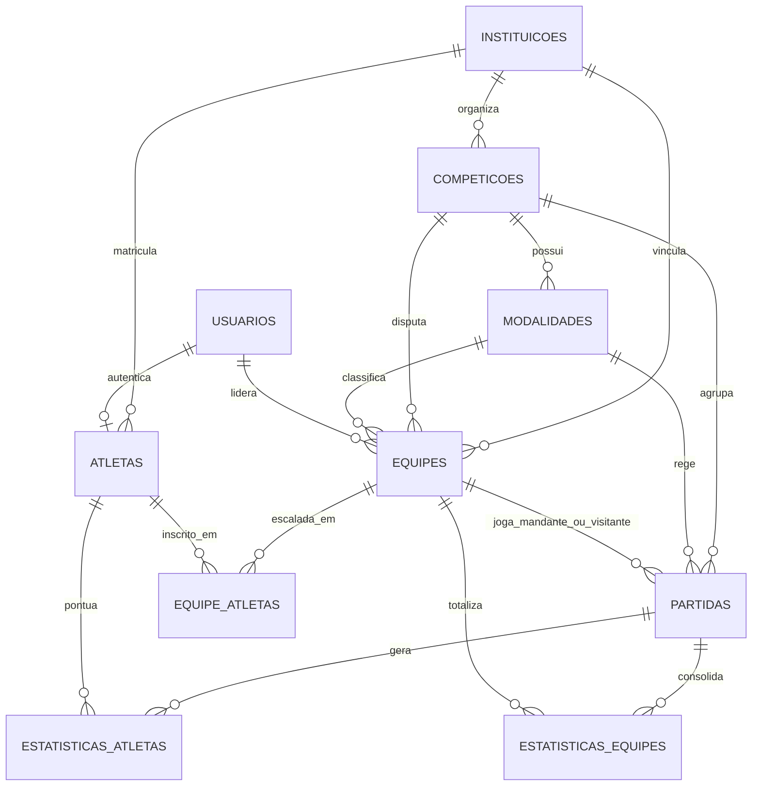

# JIF+ — Plataforma de Gestão e Inteligência Esportiva para os Jogos dos Institutos Federais

## 1. Objetivo
O JIF+ é uma plataforma web criada para centralizar as informações esportivas das competições dos Institutos Federais, unificando dados de instituições, competições, modalidades, equipes, atletas, partidas, resultados e estatísticas em um único ambiente digital. O sistema resolve o problema da fragmentação de dados esportivos dispersos em boletins, documentos em PDF e páginas isoladas, eliminando o retrabalho dos organizadores e viabilizando a consulta ágil do histórico e do desempenho de equipes e atletas. A plataforma atende a estudantes-atletas, treinadores, professores de Educação Física, coordenadores de eventos esportivos e à comunidade acadêmica em geral.

## 2. Usuários
- **Administrador Geral**: responsável pelo gerenciamento de usuários e permissões do sistema, cadastro de instituições/campi participantes, auditoria geral de registros e manutenção global da plataforma.
- **Coordenador / Organizador de Competição**: responsável por criar e gerenciar competições e modalidades, homologar equipes e atletas, programar partidas, registrar súmulas com placares e estatísticas de jogos e publicar classificações oficiais.
- **Treinador / Professor Responsável**: responsável por inscrever e gerenciar as equipes do seu campus em uma competição, cadastrar/vincular atletas do seu instituto às equipes e acompanhar estatísticas de desempenho dos seus jogos.
- **Estudante-Atleta**: usuário com acesso à sua conta pessoal para visualizar seu perfil esportivo (identidade/BID estudantil com histórico de jogos, equipes integradas e pontuações/gols), além de consultar tabelas de partidas e resultados.
- **Visitante / Público Geral (Não autenticado)**: consulta informações públicas sobre competições, tabela de jogos, resultados em tempo real, pontuações, perfis esportivos públicos de atletas e equipes e painéis de estatísticas, sem permissão para criar, editar ou excluir dados.

## 3. Casos de uso principais
- **UC01 — Cadastrar-se e autenticar-se no sistema**: permitir que novos usuários criem conta e que usuários cadastrados façam login com validação de credenciais ou encerrem a sessão (logout).
- **UC02 — Gerenciar usuários e perfis de acesso**: permitir ao administrador listar, ativar, inativar e atribuir perfis de acesso (Administrador, Organizador, Treinador, Atleta) aos usuários.
- **UC03 — Gerenciar instituições e campi**: permitir ao administrador cadastrar, editar, listar e desativar dados dos Institutos Federais e seus respectivos campi participantes.
- **UC04 — Gerenciar competições e modalidades**: permitir ao organizador criar e configurar competições (edição, ano, datas, local) e associar as modalidades esportivas correspondentes.
- **UC05 — Gerenciar equipes**: permitir a treinadores ou organizadores cadastrar equipes, vinculando-as a uma instituição, uma competição específica e uma modalidade.
- **UC06 — Gerenciar atletas e perfil esportivo**: permitir o cadastro de atletas, vinculação dos atletas às equipes e manutenção da identidade/histórico esportivo individual.
- **UC07 — Agendar e programar partidas**: permitir ao organizador cadastrar jogos esportivos informando competição, modalidade, equipes adversárias, data, horário e local da partida.
- **UC08 — Registrar resultados e estatísticas de partidas**: permitir ao organizador registrar e homologar placares finais, parciais e estatísticas individuais (gols, pontos, faltas, cartões) e coletivas de cada jogo.
- **UC09 — Consultar página da equipe e histórico**: permitir a qualquer usuário consultar os integrantes de uma equipe, jogos disputados, vitórias/derrotas e histórico de desempenho.
- **UC10 — Pesquisar e filtrar informações esportivas**: permitir a todos os usuários realizar buscas textuais e aplicar filtros combinados por instituição, modalidade, atleta, equipe, data e competição.
- **UC11 — Visualizar painéis de inteligência e desempenho**: permitir a consulta de resumos estatísticos, classificação de grupos e indicadores consolidados de atletas e equipes.
- **UC12 — Validar e persistir fluxo de negócio esportivo**: garantir que toda entrada de dados passe por validações de regras de negócio no servidor e persista de forma íntegra no banco de dados relacional.

## 4. Requisitos funcionais
- **RF01 [UC01] — Cadastro de usuário**: o sistema deve permitir o autocadastro de novos usuários mediante fornecimento de nome completo, e-mail institucional/pessoal válido e senha de acesso.
- **RF02 [UC01] — Login e controle de sessão**: o sistema deve autenticar usuários existentes com base em e-mail e senha, iniciando uma sessão segura, e oferecer opção de encerramento da sessão (logout).
- **RF03 [UC02] — Controle de perfis e permissões**: o sistema deve restringir o acesso a telas e operações conforme o perfil do usuário (Administrador, Organizador, Treinador, Atleta e Visitante), bloqueando ações não autorizadas.
- **RF04 [UC03] — Gestão de instituições**: o sistema deve permitir cadastrar, listar, atualizar e desativar instituições e seus campi (nome, sigla, campus, UF).
- **RF05 [UC04] — Gestão de competições**: o sistema deve permitir criar, listar, atualizar e encerrar competições esportivas (nome, edição, período de realização, local sede e status).
- **RF06 [UC04] — Gestão de modalidades**: o sistema deve permitir cadastrar modalidades esportivas vinculadas a uma competição, indicando categoria (masculino, feminino, misto) e formato (coletiva ou individual).
- **RF07 [UC05] — Gestão de equipes**: o sistema deve permitir cadastrar equipes vinculadas obrigatoriamente a uma instituição, uma competição e uma modalidade válida, associando um treinador responsável.
- **RF08 [UC06] — Cadastro e vínculo de atletas**: o sistema deve permitir cadastrar atletas e associá-los a uma ou mais equipes participantes da competição, registrando número da camisa e posição.
- **RF09 [UC06] — Perfil esportivo do atleta**: o sistema deve exibir uma página de perfil individual para cada atleta, contendo seus dados esportivos, equipes vinculadas, histórico de partidas disputadas e totalizadores estatísticos.
- **RF10 [UC07] — Programação de partidas**: o sistema deve permitir agendar partidas definindo competição, modalidade, duas equipes participantes da mesma modalidade/competição, data, horário, local e fase do torneio.
- **RF11 [UC08] — Registro de placares e resultados**: o sistema deve permitir ao organizador lançar e atualizar o placar final e a situação da partida (Agendada, Em Andamento, Encerrada ou Cancelada).
- **RF12 [UC08] — Registro de estatísticas esportivas**: o sistema deve permitir o lançamento de eventos e estatísticas individuais (ex.: pontos, gols, cartões, faltas) associados a um atleta e a uma partida específica.
- **RF13 [UC09] — Visualização de página de equipe**: o sistema deve disponibilizar uma página dedicada para cada equipe com sua relação de atletas, comissão técnica, partidas agendadas e histórico de resultados.
- **RF14 [UC10] — Mecanismo de busca e filtros**: o sistema deve permitir pesquisar textualmente e filtrar atletas, equipes, partidas e resultados por instituição, modalidade, ano e competição.
- **RF15 [UC11] — Painéis analíticos e relatórios de desempenho**: o sistema deve apresentar painéis visuais com resumos de desempenho, tabelas de classificação por pontos e destaques esportivos calculados a partir dos dados gravados.
- **RF16 [UC12] — Validação de regras de negócio**: o sistema deve validar no servidor a consistência dos dados, impedindo partidas entre equipes de modalidades distintas, duplicidade de inscrição de atletas em equipes conflitantes e campos obrigatórios em branco.
- **RF17 [UC12] — Persistência relacional de dados**: o sistema deve gravar todas as entidades e seus relacionamentos em banco de dados relacional, mantendo a integridade referencial para consultas futuras.

## 5. Requisitos não funcionais
- **RNF01 — Segurança no armazenamento de senhas**: as senhas dos usuários nunca devem ser armazenadas em texto puro; devem ser obrigatoriamente protegidas por funções de dispersão criptográfica (hash) robustas e seguras no backend (ex.: `password_hash()` com algoritmo `bcrypt` ou `Argon2id`).
- **RNF02 — Validação obrigatória no servidor**: todo e qualquer dado recebido de formulários deve ser rigorosamente validado e sanitizado no servidor antes de ser processado ou salvo, garantindo integridade mesmo que a validação de cliente em JavaScript seja burlada ou desativada.
- **RNF03 — Proteção contra injeção de SQL (SQL Injection)**: todas as consultas ao banco de dados devem utilizar exclusivamente consultas preparadas (prepared statements com PDO / MySQLi) e passagem de parâmetros vinculados, sendo terminantemente vedada a concatenação direta de dados de usuários em strings SQL.
- **RNF04 — Isolamento de credenciais e segredos**: nenhuma credencial de acesso ao banco de dados, chave secreta de sessão ou token de API pode constar em texto puro no código versionado; tais dados devem residir em variáveis de ambiente (`.env` listado no `.gitignore` local e configurado no painel da hospedagem).
- **RNF05 — Controle de acesso às rotas**: o sistema deve verificar a sessão ativa e o nível de privilégio no backend para cada rota protegida, impedindo que usuários sem autorização acessem páginas administrativas por manipulação manual da URL.
- **RNF06 — Privacidade e conformidade com dados pessoais**: o sistema deve coletar apenas os dados estritamente necessários ao funcionamento esportivo e restringir a exibição de dados pessoais e contatos privados dos estudantes-atletas ao público geral.
- **RNF07 — Tratamento de erros e segurança da informação**: o sistema não deve expor mensagens de erro nativas do banco de dados, nomes de tabelas ou stack traces ao usuário em tela; mensagens amigáveis devem ser exibidas ao cliente e detalhes técnicos gravados apenas em logs internos do servidor.
- **RNF08 — Comunicação segura (HTTPS)**: o sistema publicado em ambiente de produção deve operar obrigatoriamente sob o protocolo HTTPS com certificado TLS válido.
- **RNF09 — Tempo de resposta e desempenho**: as páginas de consulta pública, perfis e tabelas devem apresentar tempo de resposta de carregamento inferior a 3 segundos em condições normais de conexão com a internet.
- **RNF10 — Design responsivo e compatibilidade**: a interface web deve ser responsiva, adaptando-se confortavelmente a diferentes resoluções de tela, desde smartphones até monitores desktop, utilizando padrões modernos de HTML5 e CSS3.
- **RNF11 — Integridade e consistência relacional**: o esquema do banco de dados deve utilizar o mecanismo de armazenamento InnoDB no MySQL com restrições explícitas de chave estrangeira (`FOREIGN KEY`) e integridade referencial para evitar registros órfãos.

## 6. Modelo de dados (DER simples)

### Tabelas e Estrutura de Campos
1. **`usuarios`**
   - `id` (INT, PK, AUTO_INCREMENT): identificador único do usuário.
   - `nome` (VARCHAR(150), NOT NULL): nome completo do usuário.
   - `email` (VARCHAR(150), NOT NULL, UNIQUE): endereço de e-mail institucional/pessoal.
   - `senha_hash` (VARCHAR(255), NOT NULL): hash criptográfico da senha do usuário.
   - `perfil` (ENUM('admin', 'organizador', 'treinador', 'atleta'), NOT NULL): nível de acesso.
   - `ativo` (TINYINT(1), NOT NULL, DEFAULT 1): status de ativação da conta.
   - `criado_em` (DATETIME, NOT NULL, DEFAULT CURRENT_TIMESTAMP): data de cadastro.

2. **`instituicoes`**
   - `id` (INT, PK, AUTO_INCREMENT): identificador da instituição.
   - `nome` (VARCHAR(150), NOT NULL): nome da instituição (ex.: IFRO).
   - `sigla` (VARCHAR(30), NOT NULL): sigla oficial.
   - `campus` (VARCHAR(100), NOT NULL): campus da instituição (ex.: Porto Velho Calama).
   - `estado` (CHAR(2), NOT NULL): sigla do estado (ex.: RO).

3. **`competicoes`**
   - `id` (INT, PK, AUTO_INCREMENT): identificador da competição.
   - `instituicao_organizadora_id` (INT, NOT NULL, FK): instituição anfitriã.
   - `nome` (VARCHAR(150), NOT NULL): título do torneio (ex.: JIFRO, JIF Norte).
   - `edicao` (VARCHAR(50), NOT NULL): número ou identificador da edição.
   - `ano` (INT, NOT NULL): ano de realização.
   - `data_inicio` (DATE, NOT NULL): data de abertura.
   - `data_fim` (DATE, NOT NULL): data de encerramento.
   - `local_sede` (VARCHAR(150), NOT NULL): cidade/local sede.
   - `status` (ENUM('planejada', 'em_andamento', 'encerrada'), NOT NULL, DEFAULT 'planejada').

4. **`modalidades`**
   - `id` (INT, PK, AUTO_INCREMENT): identificador da modalidade.
   - `competicao_id` (INT, NOT NULL, FK): competição à qual a modalidade pertence.
   - `nome` (VARCHAR(100), NOT NULL): nome do esporte (ex.: Futsal, Voleibol, Atletismo).
   - `categoria` (ENUM('masculino', 'feminino', 'misto'), NOT NULL): categoria disputada.
   - `tipo` (ENUM('coletiva', 'individual'), NOT NULL): formato da modalidade.
   - `status` (ENUM('ativa', 'inativa'), NOT NULL, DEFAULT 'ativa').

5. **`equipes`**
   - `id` (INT, PK, AUTO_INCREMENT): identificador da equipe.
   - `instituicao_id` (INT, NOT NULL, FK): campus/instituição representada.
   - `competicao_id` (INT, NOT NULL, FK): competição que disputa.
   - `modalidade_id` (INT, NOT NULL, FK): modalidade específica.
   - `responsavel_id` (INT, NOT NULL, FK): treinador/professor vinculado ao time (`usuarios.id`).
   - `nome` (VARCHAR(150), NOT NULL): nome de exibição da equipe.

6. **`atletas`**
   - `id` (INT, PK, AUTO_INCREMENT): identificador do atleta.
   - `usuario_id` (INT, NULL, FK): vínculo opcional com a conta de usuário (`usuarios.id`).
   - `instituicao_id` (INT, NOT NULL, FK): campus ao qual o atleta pertence.
   - `nome` (VARCHAR(150), NOT NULL): nome completo do atleta.
   - `matricula_estudantil` (VARCHAR(50), NOT NULL): matrícula do estudante.
   - `data_nascimento` (DATE, NULL): data de nascimento.
   - `foto_url` (VARCHAR(255), NULL): URL ou caminho da foto para o BID/perfil.
   - `criado_em` (DATETIME, NOT NULL, DEFAULT CURRENT_TIMESTAMP).

7. **`equipe_atletas`**
   - `id` (INT, PK, AUTO_INCREMENT): identificador do vínculo de inscrição.
   - `equipe_id` (INT, NOT NULL, FK): equipe participante.
   - `atleta_id` (INT, NOT NULL, FK): atleta inscrito.
   - `numero_camisa` (INT, NULL): dorsal ou número do atleta na equipe.
   - `posicao` (VARCHAR(50), NULL): posição ou especialidade esportiva.
   - `status_inscricao` (ENUM('regular', 'suspenso', 'inativo'), NOT NULL, DEFAULT 'regular').

8. **`partidas`**
   - `id` (INT, PK, AUTO_INCREMENT): identificador da partida.
   - `competicao_id` (INT, NOT NULL, FK): competição da disputa.
   - `modalidade_id` (INT, NOT NULL, FK): modalidade disputada.
   - `equipe_a_id` (INT, NOT NULL, FK): primeira equipe participante.
   - `equipe_b_id` (INT, NOT NULL, FK): segunda equipe participante.
   - `fase_rodada` (VARCHAR(50), NOT NULL): fase da competição (ex.: Fase de Grupos, Semifinal, Final).
   - `data_hora` (DATETIME, NOT NULL): data e horário agendados.
   - `local_quadra` (VARCHAR(150), NOT NULL): local da disputa (ex.: Ginásio Poliesportivo Calama).
   - `placar_a` (INT, NULL, DEFAULT NULL): pontuação final da equipe A.
   - `placar_b` (INT, NULL, DEFAULT NULL): pontuação final da equipe B.
   - `situacao` (ENUM('agendada', 'em_andamento', 'encerrada', 'cancelada'), NOT NULL, DEFAULT 'agendada').

9. **`estatisticas_atletas`**
   - `id` (INT, PK, AUTO_INCREMENT): identificador do registro estatístico.
   - `partida_id` (INT, NOT NULL, FK): partida onde o evento ocorreu.
   - `atleta_id` (INT, NOT NULL, FK): atleta responsável pela estatística.
   - `equipe_id` (INT, NOT NULL, FK): equipe do atleta na partida.
   - `tipo_estatistica` (VARCHAR(50), NOT NULL): tipo do evento (ex.: gol, ponto, falta, cartao_amarelo, cartao_vermelho, assistencia).
   - `valor` (INT, NOT NULL, DEFAULT 1): quantidade ou valor computado.

10. **`estatisticas_equipes`**
    - `id` (INT, PK, AUTO_INCREMENT): identificador da estatística da equipe.
    - `partida_id` (INT, NOT NULL, FK): partida associada.
    - `equipe_id` (INT, NOT NULL, FK): equipe associada.
    - `tipo_estatistica` (VARCHAR(50), NOT NULL): indicador coletivo (ex.: pontos_total, faltas_coletivas, sets_vencidos).
    - `valor` (INT, NOT NULL): pontuação ou métrica registrada.

### Mapeamento de Chaves Estrangeiras (Relacionamentos)
- `competicoes.instituicao_organizadora_id` $\rightarrow$ `instituicoes.id`
- `modalidades.competicao_id` $\rightarrow$ `competicoes.id`
- `equipes.instituicao_id` $\rightarrow$ `instituicoes.id`
- `equipes.competicao_id` $\rightarrow$ `competicoes.id`
- `equipes.modalidade_id` $\rightarrow$ `modalidades.id`
- `equipes.responsavel_id` $\rightarrow$ `usuarios.id`
- `atletas.instituicao_id` $\rightarrow$ `instituicoes.id`
- `atletas.usuario_id` $\rightarrow$ `usuarios.id` (opcional, relação 1:1 lógica)
- `equipe_atletas.equipe_id` $\rightarrow$ `equipes.id`
- `equipe_atletas.atleta_id` $\rightarrow$ `atletas.id`
- `partidas.competicao_id` $\rightarrow$ `competicoes.id`
- `partidas.modalidade_id` $\rightarrow$ `modalidades.id`
- `partidas.equipe_a_id` $\rightarrow$ `equipes.id`
- `partidas.equipe_b_id` $\rightarrow$ `equipes.id`
- `estatisticas_atletas.partida_id` $\rightarrow$ `partidas.id`
- `estatisticas_atletas.atleta_id` $\rightarrow$ `atletas.id`
- `estatisticas_atletas.equipe_id` $\rightarrow$ `equipes.id`
- `estatisticas_equipes.partida_id` $\rightarrow$ `partidas.id`
- `estatisticas_equipes.equipe_id` $\rightarrow$ `equipes.id`

### Diagrama de Relacionamento Entidade-Relacionamento (DER em Mermaid)

### Fluxo Principal de Negócio no Banco
1. O Administrador cadastra instituições participantes e usuários com perfis correspondentes.
2. O Coordenador cria uma competição oficial (ex.: JIFRO 2026) e vincula modalidades esportivas (ex.: Futsal Masculino, Vôlei Feminino).
3. O Treinador cadastra sua equipe e inscreve os atletas do seu campus na modalidade e competição.
4. O Coordenador gera a tabela da competição agendando partidas entre equipes cadastradas.
5. Ao término de cada jogo, o Coordenador insere os placares finais e os eventos estatísticos (gols, pontuações e cartões) por atleta e equipe.
6. O sistema atualiza em tempo real as consultas públicas, calculando a classificação das equipes, o histórico esportivo (BID) dos atletas e os painéis de inteligência esportiva.

## 7. Critérios de aceite
- **CA01 (Referente a RF01 — Cadastro de Usuário)**:
  - *Dado que* um novo visitante preenche o formulário de cadastro com nome completo, e-mail inédito e senha com requisitos válidos,
  - *quando* aciona a opção "Criar Conta",
  - *então* o sistema deve persistir o usuário com a senha convertida em hash seguro, gravar a conta no banco e exibir mensagem de confirmação de cadastro com sucesso.
- **CA02 (Referente a RF02 — Autenticação e Logout)**:
  - *Dado que* um usuário cadastrado informa seu e-mail e senha corretos,
  - *quando* submete o formulário de login,
  - *então* o sistema autentica as credenciais, inicializa a sessão segura e redireciona o usuário para o painel correspondente ao seu perfil.
  - *Dado que* o usuário informa senha inválida,
  - *quando* tenta autenticar-se,
  - *então* o sistema deve rejeitar o acesso, mantendo-o na tela de login com a mensagem "Credenciais inválidas" e sem revelar se o e-mail existe.
- **CA03 (Referente a RF03 — Controle de Perfis e Acesso)**:
  - *Dado que* um usuário autenticado com perfil "Atleta" ou um visitante tenta acessar diretamente a URL administrativa de cadastro de competições,
  - *quando* a requisição atinge o servidor,
  - *então* o sistema deve interceptar o acesso, bloquear a execução e redirecionar o usuário para a página inicial com aviso de permissão negada (HTTP 403).
- **CA04 (Referente a RF04 — Gestão de Instituições)**:
  - *Dado que* o Administrador informa nome, sigla, campus e estado de um Instituto Federal,
  - *quando* submete o formulário de cadastro,
  - *então* os dados da instituição são gravados no banco de dados e passam a ser listados na seleção de campus para vínculo de equipes e atletas.
- **CA05 (Referente a RF05 — Gestão de Competições)**:
  - *Dado que* o Coordenador preenche título da competição, edição, datas de início e término válidas e seleciona a instituição organizadora,
  - *quando* salva a competição,
  - *então* o registro é gravado com status "planejada" e torna-se disponível para vinculação de modalidades e equipes.
- **CA06 (Referente a RF06 — Gestão de Modalidades)**:
  - *Dado que* existe uma competição cadastrada e o Coordenador informa o nome da modalidade, categoria e tipo,
  - *quando* conclui o cadastro,
  - *então* a modalidade é persistida vinculada à competição e disponibilizada para inscrição de equipes.
- **CA07 (Referente a RF07 — Gestão de Equipes)**:
  - *Dado que* uma competição e uma modalidade estão ativas e o Treinador informa o nome da equipe associada ao seu campus,
  - *quando* confirma a criação da equipe,
  - *então* a equipe é armazenada no banco com as chaves estrangeiras de instituição, competição e modalidade devidamente preenchidas.
- **CA08 (Referente a RF08 — Cadastro e Vínculo de Atletas)**:
  - *Dado que* uma equipe está cadastrada e o responsável submete os dados de um estudante-atleta (nome, matrícula e data de nascimento),
  - *quando* confirma a inclusão na equipe com o número da camisa,
  - *então* o sistema valida a matrícula, grava o atleta na tabela `atletas` e cria o relacionamento correspondente na tabela `equipe_atletas`.
- **CA09 (Referente a RF09 — Perfil Esportivo do Atleta)**:
  - *Dado que* um atleta possui histórico de participações, partidas e pontuações gravadas,
  - *quando* qualquer usuário acessa a página de perfil público do atleta,
  - *então* o sistema deve consultar o banco e renderizar seus dados esportivos, equipes em que jogou, partidas disputadas e total de gols/pontos acumulados.
- **CA10 (Referente a RF10 — Agendamento de Partidas)**:
  - *Dado que* existem duas equipes distintas cadastradas na mesma competição e modalidade,
  - *quando* o Coordenador agenda a partida definindo data, hora e local,
  - *então* a partida é salva com situação "agendada" e exibida no cronograma de jogos da competição.
- **CA11 (Referente a RF11 — Lançamento de Placares)**:
  - *Dado que* uma partida cadastrada é finalizada e o Coordenador informa o placar de cada equipe (ex.: Equipe A 3 x 1 Equipe B),
  - *quando* confirma o encerramento da partida,
  - *então* o sistema atualiza o status para "encerrada", persiste os placares e reflete a vitória/derrota na tabela de classificação da modalidade.
- **CA12 (Referente a RF12 — Registro de Estatísticas Individuais)**:
  - *Dado que* uma partida está em andamento ou finalizada e o Coordenador registra eventos como gols ou faltas para um atleta participante,
  - *quando* o formulário de súmula é enviado,
  - *então* cada evento é persistido na tabela `estatisticas_atletas` vinculado à partida e ao atleta, recalculando suas estatísticas no perfil esportivo.
- **CA13 (Referente a RF13 — Página da Equipe)**:
  - *Dado que* uma equipe possui elenco e jogos registrados,
  - *quando* um usuário acessa a visualização da equipe,
  - *então* o sistema lista todos os atletas vinculados, comissão técnica responsável, partidas agendadas e histórico de resultados anteriores.
- **CA14 (Referente a RF14 — Busca e Filtros)**:
  - *Dado que* o usuário preenche o campo de busca com o nome de um atleta ou seleciona filtros combinados de campus e modalidade,
  - *quando* executa a consulta,
  - *então* o sistema retorna exclusivamente os registros que atendem aos parâmetros filtrados, ou exibe mensagem amigável caso nenhum registro seja encontrado.
- **CA15 (Referente a RF15 — Painéis de Indicadores e Desempenho)**:
  - *Dado que* partidas foram finalizadas com placares e estatísticas registradas,
  - *quando* qualquer usuário navega até a seção de painéis esportivos da competição,
  - *então* o sistema deve calcular e exibir indicadores consolidados, como artilharia, melhor ataque, melhor defesa e tabela de pontuação geral por chave.
- **CA16 (Referente a RF16 — Validação no Servidor e Tratamento de Erros)**:
  - *Dado que* um usuário tenta submeter um formulário com campos obrigatórios vazios ou tenta agendar partida entre equipes de modalidades distintas,
  - *quando* a requisição chega ao backend,
  - *então* o sistema deve rejeitar a operação, não gravar dados inválidos e retornar respostas claras de validação indicando os campos a serem corrigidos.
- **CA17 (Referente a RF17 — Persistência e Integridade de Dados)**:
  - *Dado que* qualquer registro esportivo (competição, equipe, atleta, partida ou estatística) foi gravado com sucesso,
  - *quando* o servidor for reiniciado ou a página for atualizada sucessivas vezes,
  - *então* os dados devem permanecer íntegros, consistentes e recuperáveis a partir do banco de dados relacional.

## 8. Decisão de stack e deploy

### 1. Tecnologias Selecionadas (Stack Principal)
- **Backend**: **PHP 8.2+** estruturado, utilizando **PDO (PHP Data Objects)** para conexões seguras e execução de queries parametrizadas com prepared statements.
- **Frontend**: **HTML5**, **CSS3** (com layouts responsivos baseados em Flexbox/Grid) e **JavaScript nativo (ES6+)** para interatividade, máscaras de formulário e chamadas assíncronas (Fetch API).
- **Banco de Dados**: **MySQL 8.0** (ou MariaDB 10.x), configurado com mecanismo de armazenamento **InnoDB**, garantindo integridade referencial por chaves estrangeiras (`FOREIGN KEY`), transações ACID e consultas relacionais otimizadas.
- **Versionamento**: **Git** para controle de versão local e repositório hospedado no **GitHub**, seguindo fluxo de commits atômicos e descritivos por funcionalidade.

### 2. Justificativa da Escolha da Stack
- **Aproveitamento de competências técnicas**: a escolha de PHP e MySQL aproveita a base técnica e experiência do estudante Arthur Henrique Gimax Oliveira (3º ano Técnico em Informática do IFRO Calama), declarada formalmente no Formulário Centelha (conhecimentos em PHP, HTML, CSS, SQL, MySQL e construção de sistemas CRUD).
- **Foco pedagógico e segurança**: ao utilizar PHP nativo moderno com PDO e MySQL, o estudante exercita diretamente os fundamentos ensinados na disciplina de Desenvolvimento de Sistemas: validação no backend, tratamento contra SQL injection via prepared statements, hashing de senhas e modelagem relacional clara, sem complexidade acidental de frameworks externos que obscureçam a lógica.

### 3. Estratégia de Hospedagem e Deploy Compatível
- **Incompatibilidade com Vercel Tradicional**: conforme expressamente destacado na apostila do professor (*Programar com IA de forma responsável*, Fase 6), a plataforma **Vercel não oferece suporte nativo à execução de servidores PHP com Apache/Nginx e MySQL tradicional**. Indicar a Vercel diretamente para PHP/MySQL tradicional sem prever uma arquitetura compatível configuraria um erro conceitual grave.
- **Destino de Hospedagem Escolhido**:
  - Para a publicação do protótipo acadêmico em produção, será utilizada uma plataforma com suporte integral ao ecossistema LAMP (Linux, Apache, PHP, MySQL), tais como:
    1. **Alwaysdata** ou **InfinityFree**: provedores de hospedagem web gratuitos e amplamente utilizados em ambientes educacionais, com suporte pleno a PHP 8.x, phpMyAdmin e banco MySQL remoto; ou
    2. **Render** / **Railway** utilizando container (Docker) com servidor Apache+PHP e banco MySQL / MariaDB gerenciado em nuvem; ou
    3. Servidor de aplicação da infraestrutura acadêmica do IFRO.
- **Caminho Alternativo Formalizado (Se a publicação for mandatoriamente via Vercel)**:
  - Caso o professor exija como requisito estrito da Fase 6 o uso exclusivo da plataforma Vercel, a aplicação será estruturada utilizando **Next.js (React / Node.js) com TypeScript** no frontend/backend serverless e banco de dados relacional **Neon Postgres** na nuvem (que possui integração direta em um clique no painel da Vercel). Essa decisão de transição, caso adotada, será documentada no `CHANGELOG.md` e na versão final da spec na Fase 5.

### 4. Configuração de Variáveis de Ambiente e Segurança no Versionamento
- As credenciais de conexão com o banco de dados (`DB_HOST`, `DB_NAME`, `DB_USER`, `DB_PASS`) e as chaves de criptografia de sessão residirão exclusivamente em arquivos de ambiente local (`.env` ou `config.local.php`), devidamente listados no arquivo `.gitignore` para nunca serem commitados no repositório GitHub.
- No ambiente de deploy publicado, as variáveis de conexão serão configuradas diretamente no painel de controle do provedor de hospedagem, garantindo conformidade com o Checklist de Segurança (Anexo B da apostila).
